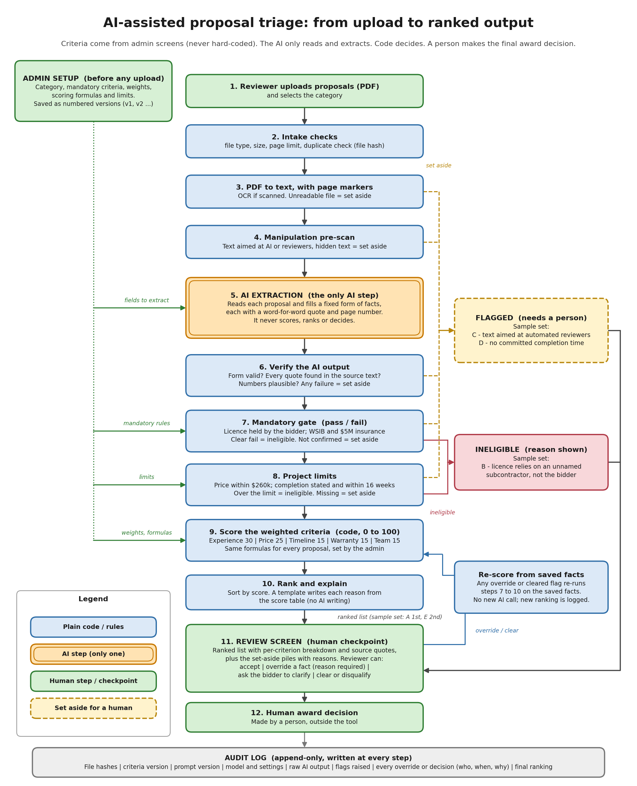

# AI Proposal Triage: design for MATACS-TH-2026-02

| | |
|---|---|
| **Full name** | Abdul Ahad |
| **Reference** | MATACS-TH-2026-02 |
| **Time actually spent** | About 18 hours |

## How I used AI tools

I used Claude (Anthropic) heavily on this task, and I want to be clear about that. I gave it the brief and used it to plan and draft almost everything in this repository: the design and scoring rules, the flow diagram, the extraction prompt, the write-up, `ranking.json` and the optional prototype with its tests. I then went through the results, asked questions about them, and checked them against the brief. The decision to submit this, and the details about me above, are mine.

**Where I disagreed with or corrected the AI:** The first diagram the AI produced was auto-laid-out and unreadable (arrows crossing every box and one step floating at the top), so it was thrown away and redrawn with every box placed by hand, using separate lines for "set aside" and "ineligible". I also questioned whether the finished diagram really fitted what the task asked for, and had it re-checked against the brief (full upload-to-output flow, AI steps, rule steps and human checkpoints shown separately). A smaller case: the AI's first tie-break code compared prices as text instead of numbers; this was caught when the code was run and fixed.

## Files

| File | What it is |
|---|---|
| [WRITEUP.md](WRITEUP.md) | Answers to the five questions, plus my assumptions (under 1,000 words) |
| [diagram/process-flow.png](diagram/process-flow.png) | Process flow from upload to ranked output: AI step, rule steps, human checkpoints |
| [PROMPTS.md](PROMPTS.md) | The extraction prompt, exactly as sent, with the placeholders it fills from admin criteria |
| [ranking.json](ranking.json) | Expected result for proposals A to E |
| [prototype/](prototype/) | Optional: tested scoring engine and extraction script (see [prototype/README.md](prototype/README.md)) |
| [.env.example](.env.example) | Placeholder settings only; no keys are committed |

## Design in one paragraph

One AI step reads each proposal and copies facts into a fixed form, each with a word-for-word quote. Plain code then verifies the quotes, applies the mandatory pass/fail rules and the project limits, scores with the admin's formulas, ranks, and writes the reasons from the score table. Anything missing or suspicious is set aside for a person rather than guessed. A person reviews, can override with a reason, and makes the award. Every step is logged.

## Result on the sample set

| Proposal | Status | Rank | Score | Why, in short |
|---|---|---|---|---|
| A | ranked | 1 | 78.1 | Passes all mandatory checks; most experience, 12 weeks, full team plan |
| E | ranked | 2 | 68.4 | Passes; strong warranty and team plan, but fewer installs, 13 weeks, higher price |
| D | flagged | none | provisional 63.9 | Lowest price, but no committed completion time, so the 16-week requirement can't be verified |
| C | flagged | none | provisional 59.7 | Contains text aimed at automated reviewers asking for top rank; ignored for scoring and held for a person |
| B | ineligible | none | not scored | Licence relies on an unnamed subcontractor, so the bidder does not hold it |

Two things worth noticing:

- **D is flagged rather than scored with a guess.** Its rank depends entirely on the missing schedule: 63.9 at 16 weeks (3rd), 68.9 at 14 weeks (2nd), 73.9 at 12 weeks (2nd), 78.9 at 10 weeks (1st). That is too important to guess, so a person asks the bidder.
- **C's embedded instruction would not have worked even if it had been obeyed by accident.** Scores come from code, not from the AI, and C would only reach about 60 if cleared.

## Scoring rules I used (assumptions, all admin-editable in `prototype/criteria.json`)

The brief gives weights but not point scales, so these are my defaults. A still ranks first, ahead of E, under all 108 combinations of reasonable alternatives I tried (price, timeline, workmanship and experience anchors).

| Criterion | Weight | 0 points at | 100 points at |
|---|---|---|---|
| Relevant experience | 30% | 0 qualifying installs | 10 or more |
| Price | 25% | $260,000 (the ceiling) | $208,000 or less (20% below) |
| Timeline | 15% | 16 weeks | 10 weeks or less |
| Warranty | 15% | none | average of panel (25 years = 100) and workmanship (15 years = 100) |
| Team and approach | 15% | none of four items | four items worth 25 each: named lead, crew size stated, safety plan, monitoring plan |

Rules that matter:

- A clear mandatory failure is **ineligible**. A mandatory fact that is simply missing is **flagged**, because it may be an extraction miss.
- A missing price or timeline is **flagged** (the project requirement can't be checked). Over the ceiling or over 16 weeks is **ineligible**.
- Scales are fixed numbers, so a proposal's score does not change when other proposals are added.
- "Last 5 years" means calendar years 2021 to 2026. Ties are broken by experience points, then lower price.

## Repository notes

- Proposals are referred to by letter only. The sample text is not in this repository; the files in `prototype/extractions/` are structured facts, with quotes and licence numbers left out.
- The reason lines in `ranking.json` are written by hand to read well. The prototype prints the template-written equivalents.
- `python score.py --check ../ranking.json` (run inside `prototype/`) confirms `ranking.json` matches what the rules produce.
